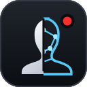
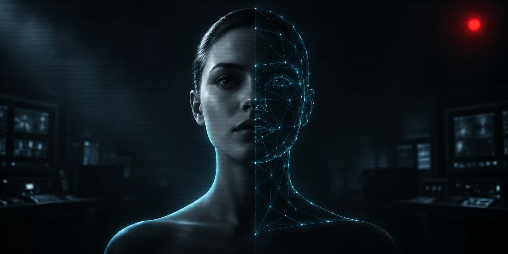

<p align="center">
  
</p>

<h1 align="center">Deepfake Studio Live</h1>

<p align="center">
  Troca de rosto em tempo real que publica direto numa câmera virtual. Um fork do Deep-Live-Cam.
</p>

<p align="center">
  <a href="README.md">English</a> · <b>Português (Brasil)</b>
</p>

<p align="center">
  
</p>

---

## Sobre este fork

Este é um fork independente do [hacksider/Deep-Live-Cam](https://github.com/hacksider/Deep-Live-Cam).
Todo o trabalho de troca de rosto — o pipeline, os modelos, o ajuste de performance — vem
daquele projeto e das pessoas creditadas no fim desta página. Este fork não reivindica nada disso.

O que este fork acrescenta:

| Mudança | Por que importa |
|---|---|
| **Câmera virtual integrada** | O projeto original manda você capturar a janela de preview com o OBS. Aqui os frames processados vão direto para uma câmera virtual que o Zoom, Discord, Teams e Meet enxergam como webcam comum. |
| **Interface reconstruída** | Arquivo e Ao vivo agora são dois modos separados, em vez de um painel só cheio de coisa. As opções avançadas ficam recolhidas, então o caminho comum é curto. |
| **Instaladores para Windows e macOS** | Um instalador pequeno que baixa tudo — o próprio Python, as dependências, o ffmpeg, os modelos de IA e a câmera virtual — com progresso real e retomada. Sem terminal, sem `pip`. |
| **Driver UnityCapture incluído** | O driver vem em `third_party/`, então não tem nada pra caçar por fora. |
| **Status real da GPU** | Um selo mostra a placa encontrada e se ela está mesmo em uso, e um clique tira os modelos da memória da placa. |
| **Funciona de primeira** | O ffmpeg vem junto, a interface segue o idioma do sistema e uma tela de carregamento aparece enquanto o app abre. |

O resto funciona igual ao original. Se você quer o projeto original, vá lá — é a implementação
de referência e tem manutenção ativa.

---

## Aviso importante

Isto é software de deepfake. Leia esta parte.

**Consentimento não é opcional.** Se você usar o rosto de uma pessoa real, peça permissão antes.
Não é formalidade — em muitos lugares usar a imagem de alguém sem consentimento é crime, e
"era só brincadeira" não serve de defesa.

**Identifique o que você publicar.** Ao compartilhar algo feito com esta ferramenta, diga que é
deepfake. As pessoas têm o direito de saber se o que estão vendo é real.

**O filtro NSFW fica.** O projeto tem uma verificação que bloqueia material impróprio.
Não remova. Se remover, o problema é seu — inclusive o jurídico.

**Uso não comercial apenas.** Os modelos de análise facial (InsightFace `buffalo_l`) são
licenciados [somente para pesquisa não comercial](https://github.com/deepinsight/insightface?tab=readme-ov-file#license).
Essa restrição vem dos autores dos modelos, não da licença deste projeto, e vale independente
do que você faça com o código.

Você é responsável pelo que criar com isto. Não os autores deste fork, nem o projeto original.

---

## Instalação

**Windows 10/11 (64-bit)**

Baixe o [DeepfakeStudioLive-Setup.exe](https://github.com/felvieira/deepfake-studio-live/releases/latest)
e execute. Quando terminar, abra o app pelo atalho **Deepfake Studio Live** na Área de
Trabalho ou no Menu Iniciar.

**macOS 13 ou mais novo, Apple Silicon (M1 em diante)**

1. Baixe o [DeepfakeStudioLive-macOS.dmg](https://github.com/felvieira/deepfake-studio-live/releases/latest),
   abra e arraste o instalador para **Aplicativos**.
2. Abra o instalador. O app ainda não é assinado por uma conta de desenvolvedor Apple, então
   na primeira vez o macOS bloqueia: vá em **Ajustes do Sistema → Privacidade e Segurança**,
   role até o fim e clique em **Abrir Mesmo Assim**. (Ou, no Terminal:
   `xattr -dr com.apple.quarantine "/Applications/Deepfake Studio Live Installer.app"`.)
3. Se faltarem as Ferramentas de Linha de Comando do Xcode, o macOS mostra a própria janela de
   instalação durante o processo — confirme e o instalador continua sozinho.
4. Quando terminar, abra o **Deepfake Studio Live** pela pasta Aplicativos, pelo Launchpad ou
   pelo Spotlight. Na primeira vez que você iniciar o modo ao vivo, o macOS pede acesso à câmera.

**O que o instalador faz (nos dois sistemas)**

Baixa um Python próprio, as dependências, o ffmpeg, os ~1,3 GB de modelos de IA e prepara a
câmera virtual. Nada é instalado no sistema, exceto o driver da câmera virtual no Windows (o
único passo que pede permissão de Administrador). Instala em `%LOCALAPPDATA%\DeepLiveCam`
no Windows e em `~/Library/Application Support/DeepLiveCam` no macOS; precisa de uns 10 GB
livres e de internet durante a instalação.

Todos os passos retomam: se um download cair no meio, rodar de novo continua de onde parou.
No fim ele diz se a aceleração por hardware está ativa.

**Atualizar**

Rode o instalador mais novo por cima do que já existe. O botão aparece como **Atualizar** em
vez de **Instalar**, ele baixa a versão nova do app e mantém os modelos e as configurações.

**Macs com Intel** não são cobertos pelo instalador; use a instalação pelo código-fonte, abaixo.

**Pelo código-fonte**

Windows (precisa de Python 3.11–3.13 e do Visual C++ Build Tools):

```bash
install.bat
venv\Scripts\python.exe run.py
```

macOS / Linux (precisa de Python 3.11–3.13; no Mac, também das Ferramentas de Linha de
Comando do Xcode):

```bash
./install.sh
./run.sh
```

O ffmpeg vem junto com as dependências (`imageio-ffmpeg`); se houver um ffmpeg no PATH, ele é
usado no lugar. Os modelos baixam na primeira abertura.

---

## Usando a câmera virtual

1. Abra o app e escolha o modo **Live camera**
2. Escolha a foto do rosto
3. Ligue **Send video to a virtual camera**
4. Clique em **Start live**
5. No Zoom, Discord, Teams ou Meet, escolha a câmera:
   - Windows: **Unity Video Capture** (o instalador já instala)
   - macOS: **O\ Virtual Camera** — instale o [O\ Studio](https://obsproject.com) (gratuito)
     e ative a câmera virtual uma vez dentro do O\; o macOS pede aprovação em Ajustes do Sistema.

Se a câmera não aparecer, reinicie o app de chamada — a maioria lista os dispositivos só ao abrir.

Para remover o driver do Windows depois: `uninstall_virtual_camera.bat`.

---

## Aceleração por GPU

- **Windows + NVIDIA:** o instalador adiciona as bibliotecas CUDA sozinho.
- **Mac com Apple Silicon:** usa o CoreML (GPU e Neural Engine) automaticamente; a gravação de
  vídeo usa o VideoToolbox.
- DirectML e OpenVINO funcionam como o upstream documenta — veja o
  [guia de GPU do upstream](https://github.com/hacksider/Deep-Live-Cam#gpu-acceleration).

O selo no canto superior direito mostra a GPU encontrada e se ela está mesmo em uso. Se disser
que a GPU foi encontrada mas **não** está em uso, a aceleração não carregou e o app está
rodando na CPU — funciona, só que bem mais devagar. **Liberar memória da GPU** (embaixo do
selo) descarrega os modelos quando você termina; parar o modo ao vivo faz isso sozinho.

---

## Situação do projeto

O que está pronto, o que foi testado e o que falta: [docs/STATUS.md](docs/STATUS.md).
Todas as telas e opções: [docs/telas.html](docs/telas.html) (baixe e abra no navegador).

---

## Licença

**AGPL-3.0**, herdada do projeto original. Resumindo: você pode usar, modificar e redistribuir,
mas o que você distribuir também tem que ser AGPL e tem que vir com o código-fonte. Se rodar
uma versão modificada como serviço de rede, você deve o fonte aos usuários também.

O texto completo está em [LICENSE](LICENSE). A restrição não comercial do InsightFace citada no
aviso vale por cima dela.

---

## Créditos

Este fork existe por causa de trabalho feito em outro lugar. O crédito é de:

- [hacksider](https://github.com/hacksider) e os [contribuidores do Deep-Live-Cam](https://github.com/hacksider/Deep-Live-Cam/graphs/contributors) — o projeto que este fork deriva
- [s0md3v](https://github.com/s0md3v/roop) — o roop original, de onde tudo isso descende
- [deepinsight](https://github.com/deepinsight) — [InsightFace](https://github.com/deepinsight/insightface), os modelos de análise facial
- [schellingb](https://github.com/schellingb/UnityCapture) — UnityCapture, o driver da câmera virtual
- [ffmpeg](https://ffmpeg.org/) — operações de vídeo
- [Henry](https://github.com/henryruhs) — contribuidor principal do projeto original

Citados no README do original pelas contribuições que fizeram lá:
[havok2-htwo](https://github.com/havok2-htwo),
[GosuDRM](https://github.com/GosuDRM),
[pereiraroland26](https://github.com/pereiraroland26),
[vic4key](https://github.com/vic4key),
[kier007](https://github.com/kier007),
[qitianai](https://github.com/qitianai),
[laurigates](https://github.com/laurigates),
[maxwbuckley](https://github.com/maxwbuckley).
